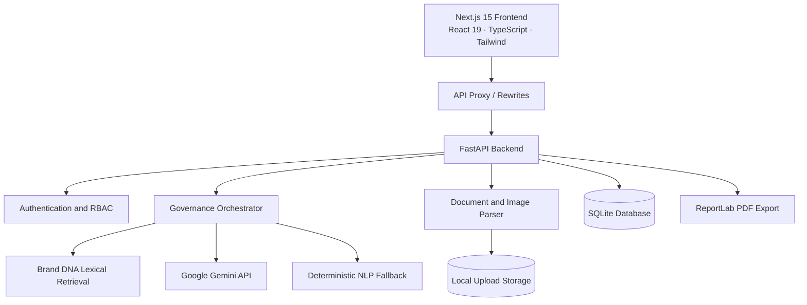

# AUREX AI — The Gold Standard of Brand Integrity

> **AI recommends. Evidence explains. Humans decide.**

AUREX AI is an AI-powered brand governance and intelligence platform that evaluates marketing copy, press releases, corporate documents, and visual assets against an organization's approved brand guidelines before publication.

Instead of treating AI output as an authority, AUREX AI connects each evaluation to a brand's **Brand DNA** repository: its verified facts, guidelines, terminology rules, and visual color tokens. It identifies supported, conflicting, and unverified claims, highlights brand inconsistencies, and provides a review workflow in which people retain the final publishing decision.

---

## Contents

- [Core Philosophy](#core-philosophy)
- [Key Features](#key-features)
- [How Governance Works](#how-governance-works)
- [Technology Stack](#technology-stack)
- [System Architecture](#system-architecture)
- [Feature Implementation Status](#feature-implementation-status)
- [Getting Started](#getting-started)
- [Environment Variables](#environment-variables)
- [Demo Accounts](#demo-accounts)
- [Application URLs](#application-urls)
- [API Overview](#api-overview)
- [Testing](#testing)
- [Deployment Notes](#deployment-notes)
- [Security](#security)
- [Known Limitations](#known-limitations)
- [Future Improvements](#future-improvements)
- [Disclaimer](#disclaimer)

---

## Core Philosophy

AUREX AI follows three principles:

1. **AI recommends** — AI analyzes content, identifies potential risks, and suggests corrections. It does not make the final publishing decision.
2. **Evidence explains** — Findings are connected to relevant Brand DNA facts or guideline information so reviewers can understand why an issue was raised.
3. **Humans decide** — Authorized reviewers retain responsibility for approving, rejecting, or requesting changes to content.

## Key Features

- **Brand DNA Knowledge Vault:** Manage brand profiles, guidelines, verified facts, terminology rules, and visual color tokens. Supports ingestion of PDF, TXT, and Markdown documents.
- **Content Submission Studio:** Submit text or supported documents and images for governance analysis. Includes sample compliant and violation test presets.
- **Evidence-Grounded Claim Verification:** Classifies extracted claims as `SUPPORTED`, `CONFLICTING`, or `UNVERIFIED`.
- **Dual-Engine Governance:** Uses Google Gemini when configured and a deterministic local rule-based NLP fallback when a Gemini API key is not available.
- **Lexical Retrieval:** Uses in-memory tokenization, term-frequency cosine similarity, and numerical/entity pattern matching over Brand DNA content. It does not require an external vector database.
- **Visual Forensics:** Inspects image properties, dimensions, dominant colors, brand-color distance, and WCAG contrast. Gemini visual analysis is available when configured.
- **Trust Passport:** Presents a Governance Index, pillar breakdown, and claim findings. An HMAC-SHA256 signature can be used to verify report integrity against the server secret.
- **PDF Export:** Generates Trust Passport reports using ReportLab.
- **Human Review Station:** Supports reviewer decisions, discussion comments, and revision history, with separation-of-duties checks.
- **Governance Insights:** Aggregates compliance metrics, terminology findings, unverified claims, and pillar scores.
- **Audit Trail:** Records governance events such as submissions, reviews, and profile changes.

## How Governance Works

1. An administrator creates a brand profile and adds its approved facts, guidelines, terminology, and visual tokens to Brand DNA.
2. A creator submits copy or an asset through the Submission Studio.
3. The governance engine evaluates the submission against the available Brand DNA evidence.
4. Claims are classified:
   - `SUPPORTED` — supported by an explicit fact in Brand DNA.
   - `CONFLICTING` — contradicts an established Brand DNA fact or policy.
   - `UNVERIFIED` — no sufficient supporting evidence was found; this does **not** automatically mean the claim is false.
5. Findings and recommendations are presented for human review.
6. An authorized reviewer approves the submission, rejects it, or requests changes.

## Technology Stack

### Frontend

- Next.js 15 (App Router)
- React 19
- TypeScript
- Tailwind CSS
- Lucide React
- `clsx` and `tailwind-merge`
- pnpm

### Backend

- Python 3.11+
- FastAPI
- Pydantic v2 and `pydantic-settings`
- SQLAlchemy 2
- Uvicorn
- PyJWT and Passlib/bcrypt
- pypdf and Pillow
- ReportLab

### AI and Retrieval

- Google Gemini API through the `google-genai` SDK
- Default model configured in the project: `gemini-2.5-flash`
- Deterministic rule-based NLP fallback
- In-memory lexical retrieval using token-frequency cosine similarity and pattern matching

### Database and File Storage

- SQLite by default
- SQLAlchemy as the ORM
- Local filesystem storage for uploads (`./uploads`)

## System Architecture



## Feature Implementation Status

| Feature | Status | Notes |
|---|---|---|
| Brand DNA workspace | Implemented | CRUD for brand profiles, guidelines, facts, terminology, and visual tokens; document ingestion for PDF, TXT, and MD. |
| Content submission studio | Implemented | Accepts text and supported document/image uploads. |
| Claim verification | Implemented | Classifies claims as `SUPPORTED`, `CONFLICTING`, or `UNVERIFIED`. |
| Dual-engine analysis | Implemented | Gemini analysis when configured; local rule-based fallback otherwise. |
| Lexical retrieval | Implemented | In-memory cosine similarity and numerical/entity pattern matching. |
| Visual forensics | Partially implemented | Pillow-based image inspection and color/contrast checks; advanced logo geometry and font detection are limited or rule-based. |
| Trust Passport | Implemented | Governance score, pillar breakdown, claim matrix, and HMAC-SHA256 integrity signature. |
| PDF export | Implemented | Server-side ReportLab export. |
| Human review station | Implemented | Review decisions, comments, revision history, and separation-of-duties checks. |
| Governance insights | Implemented | Aggregated governance metrics and findings. |
| Audit trail | Implemented | Governance events stored in the database. |
| Cloud object storage | Planned | Current uploads use local filesystem storage. |
| Database migrations | Planned | Alembic migrations are not configured. |

## Getting Started

### Prerequisites

Install the following:

- Node.js 18.18+ (Node.js 20+ recommended)
- pnpm 9+
- Python 3.11+
- Git

Install pnpm if it is not already available:

```bash
npm install -g pnpm
```

### 1. Clone the Repository

```bash
git clone https://github.com/sujalkumar29/AUREX-AI.git
cd AUREX-AI
```

### 2. Configure Environment Variables

Create your local environment file from the template:

**Windows PowerShell:**
```powershell
Copy-Item .env.example .env
```

**macOS/Linux:**
```bash
cp .env.example .env
```

Generate a secure JWT secret:

```bash
python -c "import secrets; print(secrets.token_hex(32))"
```

Copy the generated value into `JWT_SECRET_KEY` in `.env`. Add your Gemini API key to `GEMINI_API_KEY` if you want to use Gemini-powered analysis. The local rule-based fallback is used when the key is not configured.

### 3. Start the Application

#### Option A: Full-stack launcher (Windows)

From the repository root, run:

```powershell
.\start_all.ps1
```

Alternatively, run `start_all.bat` from Windows Command Prompt or double-click it in File Explorer.

#### Option B: Start services separately (Windows PowerShell)

Backend:

```powershell
.\start_backend.ps1
```

Frontend, in a second terminal:

```powershell
.\start_frontend.ps1
```

#### Option C: Manual setup

**Backend**

```bash
cd backend
python -m venv venv
```

Activate the environment:

```powershell
# Windows PowerShell
.\venv\Scripts\Activate.ps1
```

```bat
:: Windows Command Prompt
venv\Scripts\activate.bat
```

```bash
# macOS/Linux
source venv/bin/activate
```

Install dependencies and start the API:

```bash
pip install -r requirements.txt
uvicorn app.main:app --host 127.0.0.1 --port 8000 --reload
```

**Frontend** — open a second terminal:

```bash
cd frontend
pnpm install
pnpm dev
```

## Environment Variables

The backend reads configuration through `backend/app/config.py`. The following variables are documented by the project:

| Variable | Default | Purpose |
|---|---|---|
| `PROJECT_NAME` | `AUREX AI` | Application name |
| `TAGLINE` | `The Gold Standard of Brand Integrity` | Application tagline |
| `VERSION` | `1.0.0` | API version |
| `ENVIRONMENT` | `development` | Runtime environment |
| `DATABASE_URL` | `sqlite:///./aurex_ai.db` | SQLAlchemy database URL |
| `JWT_SECRET_KEY` | Empty | Secret used to sign JWTs; configure a secure value of at least 32 characters. |
| `ALGORITHM` | `HS256` | JWT signing algorithm |
| `ACCESS_TOKEN_EXPIRE_MINUTES` | `10080` | Access-token lifetime in minutes (7 days) |
| `GEMINI_API_KEY` | Empty | Optional Gemini API key |
| `GEMINI_MODEL` | `gemini-2.5-flash` | Gemini model identifier |
| `GEMINI_EMBEDDING_MODEL` | `text-embedding-004` | Embedding model configuration |
| `UPLOAD_DIR` | `./uploads` | Local upload directory |
| `MAX_UPLOAD_SIZE_MB` | `25` | Maximum upload size in MB |
| `ALLOWED_ORIGINS` | Local frontend origin | CORS origin allowlist |

Keep `.env` out of version control. Never commit API keys or production secrets.

## Demo Accounts

The application seeds development/demo personas on first database initialization. The login page includes a demo persona switcher.

| Role | Email | Password |
|---|---|---|
| Brand Director (Admin) | `admin@aurex.ai` | `aurex123` |
| Lead Copywriter (Creator) | `creator@aurex.ai` | `aurex123` |
| Brand Governance Officer (Reviewer) | `reviewer@aurex.ai` | `aurex123` |

> **Warning:** These credentials are for local development and demonstrations only. Change or disable default credentials before exposing an instance publicly.

## Application URLs

When running locally:

| Service | URL |
|---|---|
| Frontend | http://localhost:3000 |
| Backend API | http://127.0.0.1:8000 |
| Swagger UI | http://127.0.0.1:8000/docs |
| ReDoc | http://127.0.0.1:8000/redoc |

## API Overview

The backend exposes REST endpoints through FastAPI. Interactive endpoint documentation is available at `/docs` and `/redoc`.

| Area | Method | Endpoint | Purpose |
|---|---|---|---|
| System | `GET` | `/health` | Health check |
| System | `GET` | `/api/v1/system-status` | AI engine and database status |
| Authentication | `POST` | `/api/v1/auth/register` | Register a user |
| Authentication | `POST` | `/api/v1/auth/login` | Authenticate and issue a JWT |
| Authentication | `GET` | `/api/v1/auth/me` | Get the authenticated user |
| Brands | `GET` | `/api/v1/brands` | List brand profiles |
| Brands | `POST` | `/api/v1/brands` | Create a brand profile |
| Brand DNA | `GET` | `/api/v1/brand-dna/{brand_id}` | Retrieve Brand DNA |
| Submissions | `GET` | `/api/v1/submissions` | List submissions |
| Submissions | `POST` | `/api/v1/submissions` | Create a submission |
| Submissions | `POST` | `/api/v1/submissions/{id}/analyze` | Analyze a submission |
| Trust Passport | `GET` | `/api/v1/trust-passport/{id}` | Retrieve a Trust Passport |
| Trust Passport | `GET` | `/api/v1/trust-passport/{id}/pdf` | Export a Trust Passport PDF |
| Workflow | `POST` | `/api/v1/workflow/reviews` | Submit a reviewer decision |
| Workflow | `POST` | `/api/v1/workflow/comments` | Add a discussion comment |
| Insights | `GET` | `/api/v1/insights` | Retrieve governance metrics |
| Upload | `POST` | `/api/v1/upload` | Upload a supported document or image |

Protected endpoints require an `Authorization: Bearer <token>` header obtained through the login endpoint. Refer to the live Swagger documentation for the complete request and response schemas.

## Testing

The repository documents the following verification commands.

### Backend direct verification

```powershell
cd backend
python test_direct.py
```

The project notes report that this script verifies health/status checks, login and JWT generation, Brand DNA retrieval, submission analysis, Trust Passport scoring, Governance Insights, and workflow records.

### Frontend type checking

```bash
cd frontend
pnpm exec tsc --noEmit
```

### Frontend production build

```bash
cd frontend
pnpm run build
```

The project notes report a successful frontend type check and production build. The asynchronous scripts `backend/test_e2e_suite.py` and `backend/test_api.py` are available, but are not listed as verified in the project notes; Windows Python 3.13 environments may encounter ASGI event-loop teardown hangs with these scripts.

## Deployment Notes

The configuration described above is for local development. The following are deployment considerations, not a claim that a production deployment has already been completed.

### Frontend

A Next.js frontend can be deployed to Vercel with:

- Root directory: `frontend`
- Build command: `pnpm run build`

Configure the API rewrite/proxy destination in `frontend/next.config.mjs` to point to the deployed backend using an environment variable. Do not leave it pointing to `127.0.0.1:8000` in a hosted deployment.

### Backend

A FastAPI backend can be hosted on Render or another container platform. A typical start command is:

```bash
uvicorn app.main:app --host 0.0.0.0 --port $PORT
```

Configure production environment variables, including `ENVIRONMENT`, `DATABASE_URL`, `JWT_SECRET_KEY`, `ALLOWED_ORIGINS`, and (if used) `GEMINI_API_KEY`.

### Database and uploads

- SQLite is the configured default database.
- PostgreSQL deployment requires a compatible driver; one is not included in the documented default requirements.
- Alembic migrations are not currently configured.
- Uploaded files are stored locally in `UPLOAD_DIR`. Hosted environments with ephemeral filesystems require persistent disk or an object-storage integration to retain uploads across restarts and deployments.

## Security

- Keep `.env` files and secrets out of source control.
- Keep `GEMINI_API_KEY` and `JWT_SECRET_KEY` on the backend; do not expose them in frontend code.
- JWTs use the configured signing algorithm (`HS256` by default).
- Password hashing uses Passlib/bcrypt.
- Role-based permissions and separation-of-duties checks are part of the review workflow.
- Trust Passport HMAC-SHA256 signatures support integrity verification against the server secret. They are not an absolute guarantee against key compromise or database-level modification.
- Configure `ALLOWED_ORIGINS` narrowly for the environments where the frontend is hosted.

## Known Limitations

1. **Local file storage:** Uploads are stored on disk. Ephemeral hosting platforms can lose these files unless persistent storage is configured.
2. **SQLite default:** PostgreSQL requires an additional database driver and configuration.
3. **No migration pipeline:** Schema creation currently uses SQLAlchemy `Base.metadata.create_all`; Alembic migrations are not configured.
4. **Lexical retrieval:** Retrieval uses in-memory lexical similarity and pattern matching, not a dedicated vector database or embedding-based vector search.
5. **Visual forensics scope:** Current checks cover image properties, dimensions, color analysis, and contrast. Advanced logo geometry, clearspace, and typography verification are limited, rule-based, or dependent on Gemini analysis.
6. **Enterprise multi-tenancy:** The data model supports multiple brands, but full organizational tenant isolation and enterprise SSO integrations are not implemented.
7. **Async test scripts:** The asynchronous ASGI test scripts may hang during event-loop teardown in some Windows Python 3.13 environments.

## Future Improvements

- Add durable cloud object storage (AWS S3 or Google Cloud Storage).
- Introduce vector database/semantic retrieval support (for example, pgvector or ChromaDB).
- Add Alembic-based database migrations.
- Improve layout and visual verification for logo clearspace, alignment, and typography.
- Add enterprise SSO and directory integrations using SAML or OIDC.
- Add governance notifications through Slack, Microsoft Teams, and webhooks.

## Disclaimer

AUREX AI is an assistive brand-governance platform. AI evaluations, claim classifications, and remediation suggestions do not constitute legal advice or guarantee factual accuracy. Final publication, compliance, and editorial decisions remain the responsibility of authorized human reviewers.
